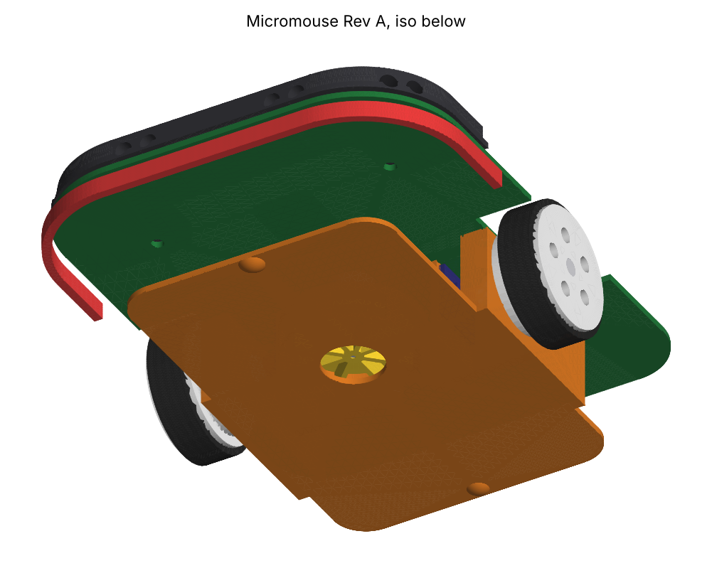
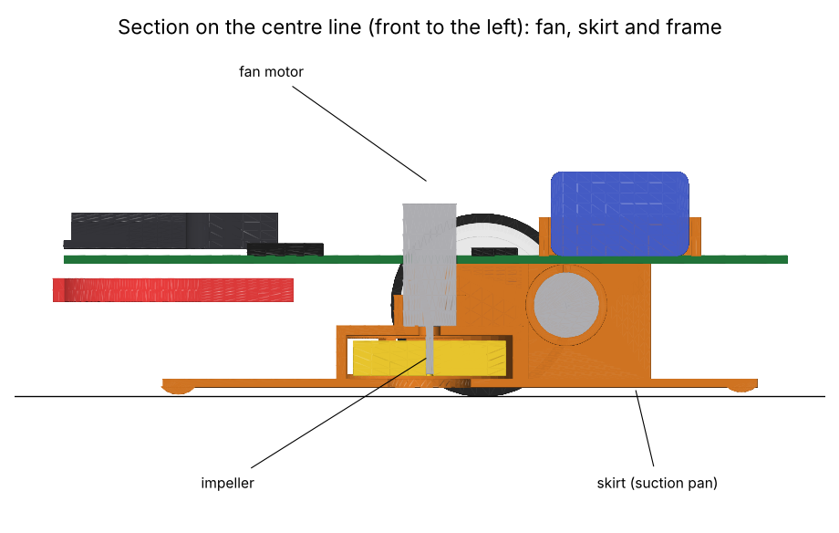
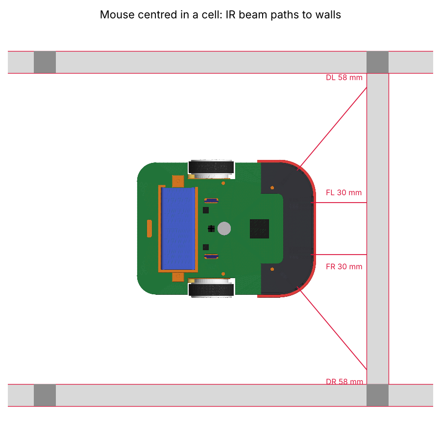
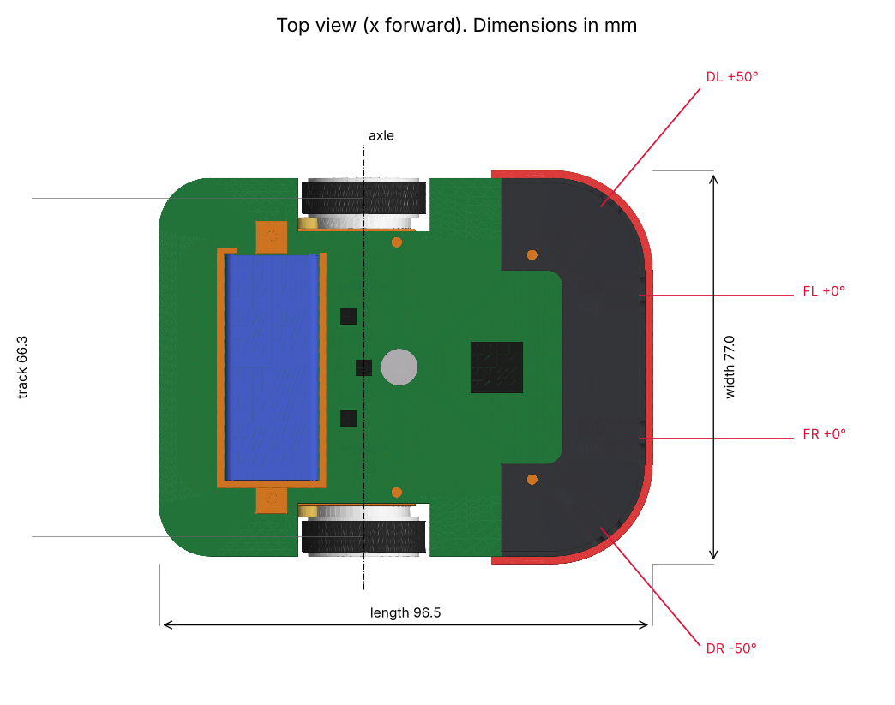
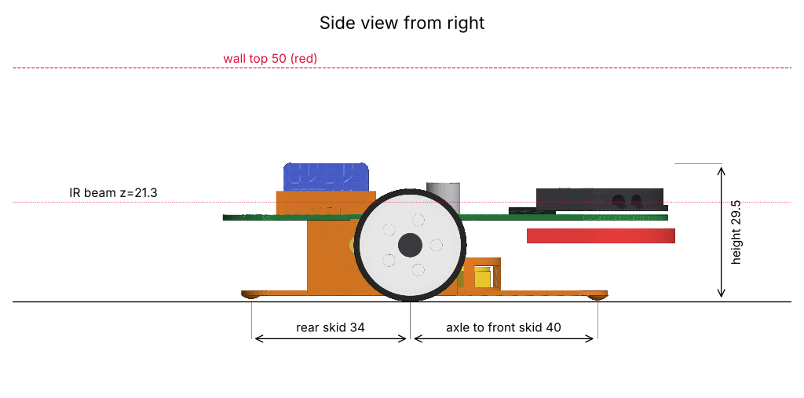

# Micromouse

An autonomous maze-solving micromouse built by students of **VIT Chennai** for the **Shaastra (IIT Madras) Micro Mouse Maze**. It is designed to the APEC/IEEE international rules and modelled on the APEC 2026 winners.

<p align="center">
  
</p>

| At a glance | Rev A (initial build) |
|---|---|
| Size and mass | 96.5 x 74 x 29.5 mm, 78 g with battery (63 g without); fits the 110 mm diagonal corridor with 18 mm a side |
| Drive | 2WD, 8520 coreless motors, 8T:36T 0.5M spur gears (4.5:1), 24 mm wheels on bearings |
| Grip | Centre-line suction fan: 0716 coreless motor, 20 mm centrifugal impeller, skirt pan 1.3 mm off the floor |
| Sensing | 4 pulsed IR pairs (SFH4550 / TEFT4300) at ±0° and ±50°; AS5047P wheel encoders; 6-axis IMU |
| Brain and power | STM32F4, 2S 240 mAh LiPo |
| Design checks | 22 of 22 pass ([build report](cad_design/build_report.md)) |
| Build it | [Build and assembly guide](documentation/build_guide.md) |
| Initial build | Fan-free variant first ([CAD](cad_design/no_fan/), 73 g); the fan version stays in the model for later |

## Table of Contents

- [About the Project](#about-the-project)
- [Project Workflow](#project-workflow)
- [Learning from the Winners](#learning-from-the-winners)
- [Hardware](#hardware)
- [CAD Models](#cad-models)
- [Research](#research)
- [Repository Layout](#repository-layout)
- [Software Used](#software-used)
- [Roadmap](#roadmap)
- [Contributors](#contributors)
- [Resources](#resources)
- [License](#license)

## About the Project

The goal is the lowest **reliable** best-run time on an unseen 16 x 16 maze. Under APEC rules a run scores its time plus total maze time / 30, inside a 7-minute window with up to 5 runs. A crashed run scores nothing, so reliability comes first and speed comes from tuning.

Three ideas set this design apart:

1. **Copy the winners' architecture, then fix their flaws.** Every subsystem traces to a mouse that placed at APEC 2026, and each known failure of those mice maps to a specific feature in our CAD.
2. **One rigid frame.** The skirt, bearing walls, motor tubes, encoder mounts, fan housing and skid domes are a single printed part. Both axle bores are cut in one operation, so the wheels are coaxial by construction.
3. **The CAD checks itself.** The model is generated from one parameter file. Every rebuild re-runs 22 checks covering interference, footprint, diagonal-run clearance, centre of gravity, grip with and without the fan, skirt and gear floor clearance, crash loads and IR beam height, and fails loudly if one breaks.

## Project Workflow

The work runs in gated phases: a phase starts only when the previous gate passes. Every number is tagged confirmed or assumed, and one variable changes per test.

| Phase | Goal | Status |
|---|---|---|
| 0 Intake | Budget, parts on hand, tools, dates | In progress |
| 1 Research | Winners' designs, rules, failure modes | **Done** ([brief](research/phase1_research_brief.md)) |
| 2 Performance budget | Mass, speed, acceleration, torque, current | Next |
| 3 Components | Scored part selection under budget | Next |
| 4 CAD | Parametric model, checks, exports | **Rev A.1 modelled**, [build guide](documentation/build_guide.md) ready; physical fit test pending |
| 5 Firmware | State machine, solver, motion, logger | [Plan](firmware/README.md) |
| 6 Testing | Bench to full-maze rehearsal, numeric pass criteria | |
| 7 Optimisation | Logged single-variable tuning | |
| 8 Competition | Checklist, venue recalibration, run strategy | |

## Learning from the Winners

| Seen in | Problem | Our fix |
|---|---|---|
| 4WD mice (micromouseonline) | All four wheels skid in every turn | 2WD with fan downforce, as on KOGUMA-CHAN (2nd, APEC 2026) |
| Decimus printed mounts | Mounts flex; 0.2 mm misalignment reverses drift | One-piece frame, axle bores cut together, two bearings per wheel |
| Decimus 2 | Diagonal sensors too far back to set up turns | Diagonal IR 46.5 mm ahead of the axle |
| Off-axis fans | Downforce lands on a skid, not the wheels | Fan on the centre line; skirt centroid 2.9 mm from the axle |
| Motor-shaft encoders | Gear backlash corrupts odometry | AS5047P magnets on the wheel axles |
| Decimus-5A, Theseus | Crashes break parts ("no crumple zones") | TPU nose bumper below the beam line |

The full table with sources is in [documentation/design_notes.md](documentation/design_notes.md).

## Hardware

| Component | Part | Why |
|---|---|---|
| Microcontroller | STM32F405 / F446 | Used by all APEC 2026 top 3: hardware encoder timers, fast ADC |
| Drive motors | 2 x 8520 coreless + 8T/36T 0.5M gears | Light and fast (ZoroBot-A, Biscuit 2) |
| Motor driver | DRV8835 | Decimus-5A |
| Fan | 0716 coreless + printed impeller, MOSFET drive | Theseus-size fan motor |
| Wall sensors | 4 x SFH4550 emitter + TEFT4300 receiver | Decimus-5A, PIGGY-ONE |
| Encoders | 2 x AS5047P + diametric magnets | KOGUMA-CHAN |
| IMU | LSM6DSR class | PIGGY-ONE, KOGUMA-CHAN |
| Battery | 2S 240 mAh LiPo | Decimus-5A |

Part numbers, prices and suppliers are fixed in Phase 3. Values marked `[A]` in [`params.py`](cad_design/source/params.py) are assumptions until then.

## CAD Models

| Assembled | Exploded |
|:---:|:---:|
|  |  |
| **Underside: skirt and fan inlet** | **Centre-line section** |
|  |  |
| **IR beams in a cell** | **Top view with dimensions** |
|  |  |
| **Diagonal run: 45° entry, V90 turn, 45° exit** | **Side view** |
|  |  |

**Open the full mouse in Fusion 360:** `cad_design/step/micromouse_revA_assembly.step`. Printable STLs are in `cad_design/stl/`. To rebuild after a change:

```bash
python3 -m pip install cadquery matplotlib shapely
cd cad_design/source && python3 build.py
```

## Research

| Document | Contents |
|---|---|
| [Phase 1 research brief](research/phase1_research_brief.md) | APEC 2026 top designs, 2WD vs 4WD, fan, IR vs ToF, MCU and IMU choice, top 5 student-build failures |
| [Rules brief](research/rules_brief.md) | APEC/IEEE values we design to; open questions for Shaastra |
| [Design notes](documentation/design_notes.md) | Reference designs, flaw-to-fix table, assumptions, print and assembly guide |

## Repository Layout

```
assets/           renders and drawings
cad_design/       parametric CAD source, STEP / STL / DXF exports, build report
documentation/    design notes and project documentation
firmware/         firmware plan (Phase 5)
research/         research briefs
```

## Software Used

- Mechanical design: [CadQuery](https://cadquery.readthedocs.io/) (Python); STEP opens in Fusion 360, FreeCAD or Onshape
- PCB design: [KiCad](https://www.kicad.org/) (planned)
- Firmware: STM32 C (planned)
- Maze simulation: [mms](https://github.com/mackorone/mms) (planned)

## Roadmap

- [x] Phase 1 research brief
- [x] Rev A parametric CAD with suction fan
- [ ] Phase 0 intake and Phase 2 performance budget
- [ ] Phase 3 component selection and BOM
- [ ] Print the frame and fit-test every part
- [ ] Main PCB in KiCad
- [ ] Flood-fill solver in simulation, then on the mouse
- [ ] Phase 6 test stages A to K

## Contributors

- Roshan Kumar ([n0tRoshan](https://github.com/n0tRoshan))
- Niteesh Narashimun ([bnitheeshnarashimunoffl](https://github.com/bnitheeshnarashimunoffl))
- Kandarp Bhardwaj ([KannuBhardwaj](https://github.com/KannuBhardwaj))

VIT Chennai

## Resources

- [APEC 2026 Micromouse Contest Report](https://apec-conf.org/wp-content/uploads/2026/05/APEC-2026-Micromouse-Contest-Report-V2.pdf)
- [Micromouse Online](https://micromouseonline.com/)
- [UKMARS](https://ukmars.org/)
- [mms simulator](https://github.com/mackorone/mms)

## Acknowledgements

Repository layout inspired by [Ojasp21/Micromouse](https://github.com/Ojasp21/Micromouse) (SRA VJTI Eklavya). Design lessons from the builders of Decimus, KOGUMA-CHAN, PIGGY-ONE, ZoroBot, Biscuit and Theseus, as published in the APEC 2026 contest report and on Micromouse Online.

## License

[MIT](LICENSE)
