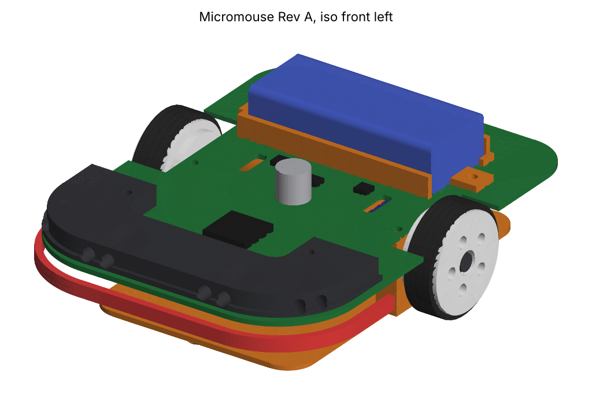
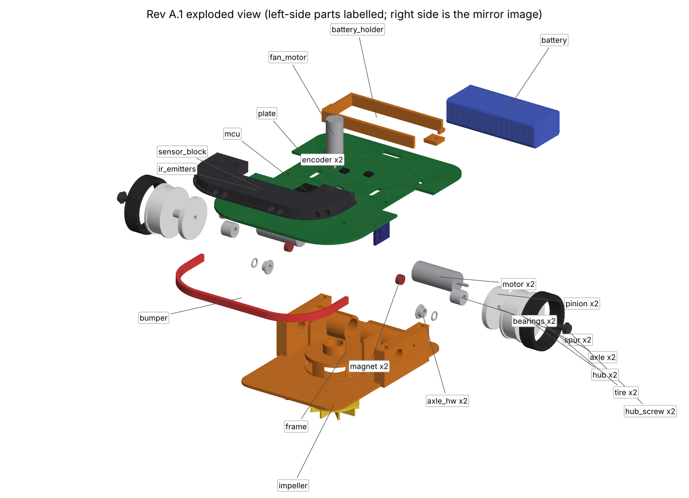
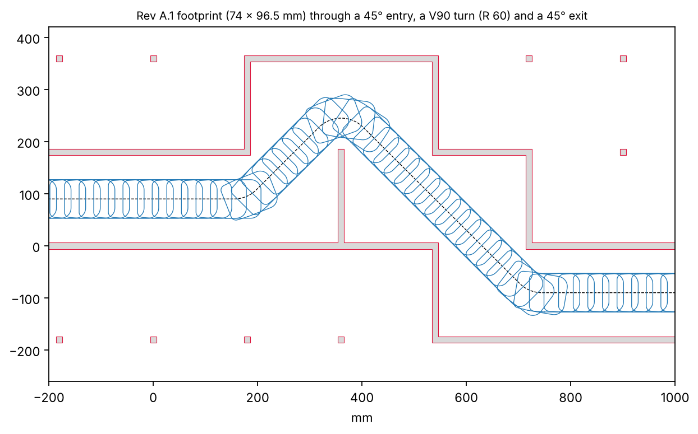

# Rev A.1 build and assembly guide

Date: 2026-10-21 · Phases 2-6 hand-off for the initial build · Rules: APEC/IEEE, stricter value where they differ ([rules brief](../research/rules_brief.md))

Tags: **[C: source]** confirmed, **[A]** assumed (measure or verify before relying on it), **[D]** design choice (reasoning in [design_notes.md](design_notes.md)). **Prices and stock are unverified**: every supplier column below is a place to check, not a quote. Fill in price, stock and lead time when you order (Phase 3).

Model: `cad_design/step/micromouse_revA_assembly.step` (open in Fusion 360). Generated numbers: [`cad_design/build_report.md`](../cad_design/build_report.md), 22 of 22 checks pass.

| | |
|:---:|:---:|
|  |  |

---

## 1. Performance numbers (Phase 2 budget, from the CAD)

These drive the part choices below. Mass comes from the CAD with assumed part masses, so weigh every part on arrival (Phase 6A) and rerun `build.py`.

| Quantity | Formula | Value | Tag |
|---|---|---|---|
| Total mass | CAD mass table | 77.7 g (62.7 g without battery) | [A] bought-part masses |
| Size | CAD | 96.5 x 74.0 x 29.5 mm | [D] |
| Wheel radius r | 24 mm wheel | 12 mm | [D] |
| Gear ratio N | 36T / 8T | 4.5 : 1 | [D] |
| Acceleration target a (fan off) | Phase 2 start value | 4 m/s² | [C: project instructions] |
| Torque per wheel | m·a·r / 2 | 0.0777 x 4 x 0.012 / 2 = **1.86 mN·m** | [A] mass |
| Torque per motor | wheel torque / (N·η), gear η = 0.85 | 1.86 / (4.5 x 0.85) = **0.49 mN·m** | [A] η |
| Torque per motor at 10 m/s² (fan on) | same | **1.22 mN·m** | [A] |
| Grip limit, fan off | build report (μ = 1.0) | 6.9 m/s² ≥ 4 m/s² target: PASS | [A] μ |
| Grip limit, fan on at 150 gf | build report | 19.4 m/s² braking, 20.7 m/s² accelerating | [A] fan force |
| Motor speed at 1.0 m/s cruise | v / (2πr) x 60 x N | 796 rpm wheel, **3,581 rpm** motor | |
| Motor speed at 3.0 m/s | same | **10,743 rpm** motor | |
| Motor speed at 5.0 m/s (Decimus-5A top speed) | same | **17,905 rpm** motor | [C: APEC 2026 report] for 5 m/s |
| Encoder resolution | 2π·r / 4096 (AS5047P ABI, ABIBIN = 1) | **0.0184 mm per count** | [C: AS5047P datasheet, ABI 4096 steps/rev] |
| Encoder count rate at 5 m/s | 5000 / 0.0184 | 272 k counts/s (timer encoder mode, no CPU load) | |
| Stall current per drive motor | V_batt / R_winding | **Unknown: 8520 winding resistance [A] not published by the sellers**. At 8.4 V and an assumed 1.5 Ω it is 5.6 A | [A] |
| Driver limit (DRV8835) | | 1.5 A per H-bridge, VM ≤ 11 V, 305 mΩ | [C: TI DRV8835 product page] |
| Fan current | | 0.6 A at working PWM | [A] |

**Open electrical risk (must close in Phase 3).** 8520 motors are sold as 3.7 V motors, and on a 2S pack their stall current is likely well above the DRV8835's 1.5 A. Until Phase 3 picks the driver, firmware caps the drive duty at `D_max = 1.5 A x R_measured / V_batt` (measure R in 6A), and the motor PWM is scaled by battery voltage. Phase 3 should score a higher-current driver (for example two single-channel drivers) against the DRV8835. The same applies to the 0716 fan motor: cap its duty so its average voltage stays at or below its rating.

**Battery runtime check.** 240 mAh, 80 % usable [A] = 192 mAh. Assumed average draw while running = 2 x 0.5 A drive + 0.6 A fan + 0.15 A logic and IR = 1.75 A [A]. That gives about **6.6 min of running per charge**. A speed run is about 10 s [A], so 20 full speed runs need about 3.3 min: PASS on paper. A full 7-minute window with the fan always on would not fit, so the fan only spins during runs, and you carry two charged packs. Phase 6I measures this.

---

## 2. Diagonal running: does the mouse fit?

Owner question (2026-10-21): to run diagonals quickly, does the mouse need to be much smaller? **Rev A already fit. Rev A.1 trims the width from 77 to 74 mm for extra margin.**

The limit is the gap between the post corners when the mouse cuts a 45° staircase. Each corner sits (CELL/2 - WALL_T)/√2 = (90 - 12)/√2 = 55.2 mm from the diagonal centre line, so the corridor is **110.3 mm wide** [C: geometry from APEC rules I.1, 180 mm cells and 12 mm posts].

| Check (build report) | Rev A (77 mm) | Rev A.1 (74 mm) |
|---|---|---|
| Clearance to the posts per side, centred | 16.7 mm | **18.2 mm** |
| Same, with ±5 mm lateral and ±5° heading error together [A] | 8.5 mm | **10.0 mm** |
| 45° turn in and out, radius 45-110 mm, with errors | 8.5 mm | **10.0 mm** |
| V90 (diagonal to diagonal) turn with errors | passes at R ≤ 75 mm | **passes at R ≤ 75 mm** (4.0 mm at R 90) |
| Width across the corridor at 5° heading error | 81.1 mm | **78.1 mm** |

The required clearance is 5 mm with both errors applied [D], so both versions pass. For comparison, Decimus-5A, which won APEC 2026 with diagonal runs, is 76 x 97 mm [C: APEC 2026 report]. Making the mouse "significantly" smaller would mean shorter motors and a narrower track, which costs torque and stability for clearance it does not need.

What this means for firmware: keep the V90 turn radius at 75 mm or less, and treat a heading error above 5° on a diagonal as a FAULT-worthy condition (Phase 6E aims for under 2°). On a diagonal straight the ±50° diagonal sensors see a wall or post within 180 mm [A] over 89 % of each 180 mm period (31-195 mm). The front pair looks along the corridor and only sees the wall where the diagonal ends.

---

## 3. Bill of materials

Prices, stock and lead times: **unverified**. Check them at order time and fill in the last columns. Suppliers named here are places to check, not confirmed stock.

### 3.1 Bought parts

| # | Part | Part number / spec | Qty (+spares) | Where to check | Price INR | Lead time |
|---|---|---|---|---|---|---|
| 1 | Drive motor | 8520 coreless, 8.5 x 20 mm, 1 mm shaft, 3.7 V class [A] | 2 (+2) | Robu.in, AliExpress, drone-parts sellers | unverified | unverified |
| 2 | Pinion | 8T module 0.5, 1.0 mm bore, brass | 2 (+4) | AliExpress (micro gear sets) | unverified | unverified |
| 3 | Spur gear | 36T module 0.5, 3 mm bore, 2 mm wide, POM/nylon | 2 (+2) | AliExpress | unverified | unverified |
| 4 | Bearing | MR63ZZ, 3 x 6 x 2.5 mm [C: MR63 catalogue size] | 4 (+4) | Robu.in, Amazon.in, local bearing shops | unverified | unverified |
| 5 | Axle | 3 mm stainless rod (303/304, low magnetism), cut to 16.0 mm [D] | 2 (+2) | local, AliExpress | unverified | unverified |
| 6 | E-clip | stainless, for 3 mm shaft, groove 2.3 mm (DIN 6799 type) [A] | 2 (+6) | AliExpress, Amazon.in | unverified | unverified |
| 7 | Spacer and shim | 3.1 ID x 4.0 OD x 1.9 mm brass tube; 3.1 x 4.0 x 0.3 mm shim [A] | 2 + 2 (+4) | cut from brass tube; shim washer kits | unverified | unverified |
| 8 | Hub screw | M2 x 4 screw + M2 washer (5 mm OD), stainless | 2 (+4) | local | unverified | unverified |
| 9 | Encoder magnet | 4 x 2 mm diametric NdFeB [A]; datasheet reference magnet is 8 x 3 mm, so check field strength in 6A | 2 (+2) | AliExpress (AS5047/AS5600 magnets) | unverified | unverified |
| 10 | Encoder | AS5047P on a ~10 x 10 mm breakout [A] (or on a small custom board) | 2 (+1) | Mouser India, DigiKey India, element14 | unverified | unverified |
| 11 | Fan motor | 0716 coreless, 7 x 16 mm, 1 mm shaft [A] | 1 (+2) | drone-parts sellers, AliExpress | unverified | unverified |
| 12 | IR emitter | SFH4550 (ams OSRAM), 3 mm, 860 nm [C: Decimus-5A uses it, APEC 2026 report] | 4 (+4) | Mouser India, DigiKey India | unverified | unverified |
| 13 | IR receiver | TEFT4300 (Vishay), 3 mm phototransistor [C: Decimus-5A] | 4 (+4) | Mouser India, DigiKey India | unverified | unverified |
| 14 | MCU | STM32F405RGT6, LQFP64 [D: all APEC 2026 top 3 use STM32] | 1 (+1) | Mouser, DigiKey, LCSC (with PCB assembly) | unverified | unverified |
| 15 | IMU | LSM6DSR (or LSM6DSRX), SPI [D: PIGGY-ONE, KOGUMA-CHAN] | 1 (+1) | Mouser, DigiKey, LCSC | unverified | unverified |
| 16 | Motor driver | DRV8835DSSR [A]: see the stall-current risk in §1 | 1 (+1) | Mouser, DigiKey, LCSC | unverified | unverified |
| 17 | Fan switch | logic-level N-MOSFET (for example AO3400A) + flyback Schottky [A] | 1 (+2) | LCSC, local | unverified | unverified |
| 18 | Emitter switches | logic-level N-MOSFET x4 + current resistors [A] | 4 (+2) | LCSC, local | unverified | unverified |
| 19 | 3.3 V supply | buck or LDO rated ≥ 10 V in, ≥ 300 mA (choose in Phase 3) [A] | 1 | Mouser, DigiKey, LCSC | unverified | unverified |
| 20 | Battery | 2S 7.4 V LiPo, ~240 mAh, ≤ 18 x 44 x 11 mm, ≤ 15 g [A: Decimus-5A uses 2S 240 mAh] | 2 (+1) | RC hobby shops, Robu.in | unverified | unverified |
| 21 | Tyres | silicone or PU ring, 20 mm ID x 24 mm OD x 6 mm [A] (or cast your own in silicone) | 2 (+4) | AliExpress (mini-4WD / micromouse tyres) | unverified | unverified |
| 22 | Heat-set inserts | M2 x 3, 3.2 mm hole [C: typical insert hole] | 4 (+6) | local, Amazon.in | unverified | unverified |
| 23 | Screws | M2 x 4 (frame, 4), M2 x 6 (sensor block 2, battery holder 2) | 8 (+10) | local | unverified | unverified |
| 24 | Connectors | JST-SH 1.0 mm: 8-pin x2 (encoders), 2-pin x2 (motors), 4-pin (UART log); JST-PH 2-pin (battery) | set | LCSC, Robu.in | unverified | unverified |
| 25 | Power | slide switch, reverse-polarity P-MOSFET, 2 x 47-100 µF low-ESR at the driver [A] | set | LCSC | unverified | unverified |
| 26 | Misc | 30 AWG silicone wire, PTFE tape (skid domes), 5-minute epoxy, threadlocker (low strength) | | local | unverified | unverified |

Single points of failure, buy spares first: drive motors, pinions, encoders, IR LEDs, battery, tyres. A spare MCU and IMU only matter if you hand-solder.

### 3.2 Printed and fabricated parts

| Part | File | Material | Qty |
|---|---|---|---|
| frame | `cad_design/stl/frame.stl` | PETG (PA-CF if you can) | 1 (+1) |
| hub | `cad_design/stl/hub_L.stl`, `hub_R.stl` | PETG | 2 (+2) |
| impeller | `cad_design/stl/impeller.stl` | resin (preferred) or PETG | 1 (+2) |
| sensor_block | `cad_design/stl/sensor_block.stl` | matte black PETG | 1 (+1) |
| battery_holder | `cad_design/stl/battery_holder.stl` | PETG | 1 |
| bumper | `cad_design/stl/bumper.stl` | TPU 95A | 1 (+1) |
| plate | `cad_design/step/plate_outline.dxf` for the KiCad edge cut | 1.0 mm FR4 PCB | 1 (+ spare boards) |

`plate.stl` is only for a printed fit-check plate (Phase 4 prototype). Do not use it as the real chassis.

---

## 4. Print settings (FDM, 0.4 mm nozzle [A: printer not confirmed in Phase 0])

| Part | Orientation | Layer | Perimeters / infill | Notes |
|---|---|---|---|---|
| frame | skirt flat on the bed | 0.12-0.16 mm | 4 walls, 6 top/bottom, 50 % gyroid | The motor-tube slit opens the top of each tube, so the tubes print without bridging. The skirt must be flat because it sets the 1.3 mm floor gap: use a clean bed and a brim, no raft. Load from braking runs along the layers. |
| hub_L / hub_R | outer face down | 0.12 mm | 100 % | D-bore: ream or file to fit the axle flat with no play |
| impeller | backplate down | resin 0.05 mm or FDM 0.08 mm | 100 % | Blades are 0.8 mm. Balance on the motor before fitting |
| sensor_block | flat (base down) | 0.12 mm | 3 walls, 40 % | Matte black only. Drill the 8 bores to 3.2 mm if they sag |
| battery_holder | flat | 0.16 mm | 3 walls, 40 % | |
| bumper | flat | 0.16 mm | 3 walls, 30 % | TPU 95A, slow (20-25 mm/s) |

Clearances [D]: 0.2-0.3 mm for slide fits (battery, sensor block bosses), 0 mm nominal for reamed bores. Print a test coupon with a 6.0 mm and a 3.0 mm hole first and adjust your slicer's hole compensation.

Post-processing:
1. Ream both bearing bores to 6.0 mm in one pass with a 6 mm reamer pushed through both walls. This keeps the axles coaxial.
2. Ream the hub bores to 3.0 mm, then file the flat to match the axle.
3. Press the four M2 heat-set inserts into the wall tops (soldering iron at ~220 °C for PETG [A]).
4. Cover each skid dome with one layer of PTFE tape.

---

## 5. Axle preparation (per side)

1. Cut 3 mm stainless rod to 16.0 mm [D] (axle spans y = 19.0 to 35.0 mm in the model: 3.0 mm inboard of the wall, 13.0 mm through the wall, gear and hub).
2. Grind or file a 0.5 mm deep flat along the outer 5.7 mm (the hub length minus the counterbore).
3. Drill 1.6 mm, 4 mm deep in the outer end, and tap M2.
4. Cut the e-clip groove to 2.3 mm diameter, 0.4 mm wide, starting 0.7 mm from the inner end (so it sits 1.9 mm inboard of the inner bearing face, where the spacer ends). A small lathe is easiest; a rotary tool with a cut-off disc works with care.

---

## 6. Assembly order

Do a dry fit of every step before any glue. The labelled exploded view is `assets/exploded.png`.

1. **Frame prep.** Inserts in, bearing bores reamed, skids taped (§4).
2. **Bearings.** Press two MR63ZZ into each wall bore, flush with both faces.
3. **Axle.** From inside the frame, slide the spacer onto the axle and push the axle out through both bearings. Fit the e-clip in the groove. Check: the spacer is clamped between the e-clip and the inner bearing's inner race.
4. **Magnet.** Epoxy the 4 x 2 mm magnet centred on the axle's inner end face. Mark the diametric axis. Let it cure.
5. **Wheel.** Epoxy the 36T spur to the inner face of the hub, concentric. Put the 0.3 mm shim on the axle outside the bearing. Slide the hub on (D-flat engages). Fit the washer and M2 x 4 screw with a drop of low-strength threadlocker, snug only. Stretch the tyre between the hub lips.
6. **Check end play and spin.** Wheel should spin freely for 2+ s from a flick [A], with end play under 0.1 mm. If it is tight, sand the spacer; if it is loose, add a shim.
7. **Drive motors.** Press the 8T pinion onto each motor shaft (support the shaft's back end while pressing). Slide each motor into its tube from the centre until the pinion meshes with the spur. Leave a hair of backlash (a paper strip run through the mesh should come out marked, not torn). Lead wires exit the inner end of each tube.
8. **Encoders.** Fix each AS5047P board to its rib with the chip centred on the axle and facing the magnet, 1.0 mm gap [A]. Use epoxy or M1.6 screws, not foam tape, because the gap must not drift. Run the 8 wires up through the plate's encoder slot.
9. **Fan.** Push the impeller onto the fan-motor shaft so that it will hang 0.5 mm above the skirt. Drop the motor into its collar from above. Spin it by hand: no rub.
10. **Route motor leads.** Run both motor lead pairs back over the skirt, inboard of the walls (away from the gears and tyres), and up through the tail slot behind the battery. Tie them down with a dab of hot glue on the skirt.
11. **PCB.** Lower the PCB on with the fan motor through its hole and the encoder wires through their slots. Fix with 4 x M2 x 4 into the inserts.
12. **Sensors.** Seat the 4 emitters (outboard bore of each pair) and 4 receivers (inboard) fully in the sensor block. Bend the legs down into the PCB holes behind the block, fit the block with 2 x M2 x 6, then solder.
13. **Bumper.** Stretch the TPU bumper over the nose under the plate edge. Fix with two spots of flexible CA.
14. **Battery holder.** Screw it down (2 x M2 x 6). Slide the pack in from the left and strap it.
15. **Weigh it.** Record the mass of each part as you go and update the masses in `params.py`. Rerun `build.py` and keep the CG check green.

### Serviceability (Gate 4 item, test it physically)

| Swap | How | Tools |
|---|---|---|
| Battery | Unstrap, slide out, unplug JST-PH | none |
| Tyre | Peel off, stretch a new one on | none |
| Whole wheel (hub, spur, tyre) | Remove the M2 hub screw, slide the hub off the D-flat. The axle, bearings and encoder magnet stay put, so encoder calibration is untouched | 1.5 mm hex |
| IR LED | Remove 2 screws, lift the sensor block, desolder 2 legs | iron |
| Fan motor or impeller | Lift the PCB (4 screws) | 1.5 mm hex |

---

## 7. Wiring

Proposed STM32F405RGT6 pin map [D]. Check it against the datasheet's alternate-function table when you draw the schematic in Phase 3; nothing here is final until then.

| Signal | MCU pin | Peripheral | Connector | Notes |
|---|---|---|---|---|
| Left motor IN1 / IN2 | PC6 / PC7 | TIM8 CH1 / CH2 PWM, 20-30 kHz | J2 MOT_L (JST-SH 2) | DRV8835 IN/IN mode |
| Right motor IN1 / IN2 | PC8 / PC9 | TIM8 CH3 / CH4 PWM | J3 MOT_R (JST-SH 2) | |
| Left encoder A / B | PA15 / PB3 | TIM2 encoder mode (32-bit) | J4 ENC_L (JST-SH 8) | free PB3/PA15 by using SWD only |
| Right encoder A / B | PA0 / PA1 | TIM5 encoder mode (32-bit) | J5 ENC_R (JST-SH 8) | |
| Encoder SPI (config, diagnostics) | PB13 SCK, PB14 MISO, PB15 MOSI; CS PB12 (L), PB1 (R) | SPI2, mode 1, ≤ 10 MHz [C: AS5047P datasheet] | J4, J5 | read AGC and MAGH/MAGL at boot |
| IMU | PA5 SCK, PA6 MISO, PA7 MOSI, CS PA4 | SPI1 | on board | at the turn centre (x = 0, y = 0) |
| IR receivers FL, FR, DL, DR | PC0, PC1, PC2, PC3 | ADC1/2 IN10-13 | on board | sample with emitter off, then on; subtract |
| IR emitters FL, FR, DL, DR | PB4, PB5, PB8, PB9 | GPIO to 4 N-MOSFETs | on board | pulse ≤ 100 µs [A]; set current with the series resistor after 6C |
| Fan | PB0 | TIM3 CH3 PWM to MOSFET | pads by the fan hole | flyback diode across the motor; soft start |
| Battery voltage | PC4 | ADC IN14 via divider (for example 100k/47k) [A] | | low-voltage cutoff and PWM scaling |
| Start / select buttons | PC14 / PC15 | GPIO in, pull-up | on board | |
| Status LEDs | PB10 / PB11 | GPIO | on board | |
| Logger UART | PA9 TX / PA10 RX | USART1, 921600 baud [D] | J8 LOG (JST-SH 4) | per-cell log, required by Phase 5 |
| Programming | PA13 SWDIO / PA14 SWCLK | SWD | J7 (5-pin 1.27 mm or Tag-Connect) | |

Power path: battery J1 (JST-PH 2) → slide switch → reverse-polarity P-MOSFET → VBAT rail. VBAT feeds DRV8835 VM (bulk 47-100 µF low-ESR at the pins), the fan MOSFET and the emitter LEDs. A 3.3 V regulator feeds the MCU, IMU, encoders (3.3 V mode: VDD and VREG tied [C: AS5047P datasheet]) and DRV8835 VCC.

Wire routing rules: every wire stays inboard of the bearing walls (tyres and gears are outboard), motor leads exit at the tail slot, encoder leads go straight up through their slots, nothing crosses the fan inlet or the exhaust windows.

---

## 8. First power-up

Do these in order and stop at the first failure.

1. **Continuity, no battery.** VBAT to GND, 3V3 to GND: no short (> 1 kΩ). Each motor connector measures the motor's winding resistance: **write R down**, it sets `D_max` (§1).
2. **Current-limited supply.** Bench supply at 7.4 V, limit 100 mA, on J1. Idle draw < 60 mA [A]. 3V3 rail at 3.25-3.35 V.
3. **SWD.** Connect, read the chip ID, flash a blink. Both status LEDs work.
4. **UART log.** Prints battery voltage within ±0.05 V of a multimeter reading.
5. **IMU.** WHO_AM_I reads correctly; gyro Z bias logged at rest.
6. **Encoders.** AGC and magnet-field flags in range (no MAGH/MAGL). Turn each wheel by hand 10 times: **40,960 ± 4 counts** [C: 4096 steps/rev from the datasheet].
7. **IR.** With the emitter off, readings sit near ambient. With a white card at 30 mm, all four rise clearly. Check FL against FR.
8. **Motors, wheels in the air.** Raise the current limit to 1 A. Run each motor at 10 % duty both ways and check that the encoder count direction matches the commanded direction.
9. **Fan.** 10 % duty, then 30 %, wheels in the air. No rub or vibration.
10. **Battery.** Only now plug in the LiPo, with the low-voltage cutoff set to 3.5 V per cell [A].

---

## 9. What to test first (Phase 6, in order)

Each stage has a numeric pass rule and must pass before the next starts. Log everything (date, firmware version, constant, old → new, result).

| Stage | First tests on this mouse | Pass |
|---|---|---|
| A. Incoming | Weigh every part, update `params.py`. Measure each motor's R, no-load current and speed. Encoder 10-rev count. Gyro bias over 5 min. Fan downforce on a kitchen scale (mouse upside-down on a spacer, or a pan mock-up) | Masses within 10 % of the table, or CG rechecked. 40,960 ± 4 counts. Fan ≥ 150 gf [A] or update `FAN_DOWNFORCE_G` |
| B. Electrical | Both motors stalled for 1 s at `D_max`; fan on; watch 3V3 and resets | No reset, no corrupted readings |
| C. IR calibration | Raw IR at 0-100 mm from a real wall, dim / normal / bright light, full and half battery. Build a lookup table. Also measure the longest reliable range (sets `IR_RANGE`, assumed 180 mm) | Repeat within your stated tolerance over 10 trials |
| D. Straight line | Wall-centering P, then D, then I only if needed, fan off first | Lateral tolerance held over 10 cells, 10 of 10 |
| E. Turns | Gyro 90° and 180° turns | < 2° error over 10 turns, no drift |
| F, G. Speed | +0.1 m/s steps on 4 cells, fan off, then repeat with fan on (one variable per test) | Last clean speed recorded |
| Diagonals (after G) | 45° in/out and V90 at R ≤ 75 mm on a staircase test section | 10 of 10 with no post contact |
| H-K | Full maze, 20-run endurance, fault injection, 7-minute rehearsal | per the project instructions |

---

## 10. Things still to verify (assumptions register additions)

| ID | Assumption | Effect if wrong | Check in |
|---|---|---|---|
| C9 | 8520 winding resistance and stall current | Driver choice, duty cap | 6A, Phase 3 |
| C10 | 4 x 2 mm magnet gives 35-70 mT at 1 mm gap | Encoder noise | 6A (AGC, MAGH/MAGL) |
| C11 | MR63ZZ shield bore > 4.0 mm, so the spacer and shim touch only the inner race | Drag | calipers on arrival |
| C12 | Heading error on diagonals stays under 5°, lateral under 5 mm | Post contact | 6E and the diagonal stage |
| C13 | IR range 180 mm for diagonal wall reads | Diagonal correction | 6C |
| C14 | Average draw 1.75 A while running | Runs per charge | 6I |
